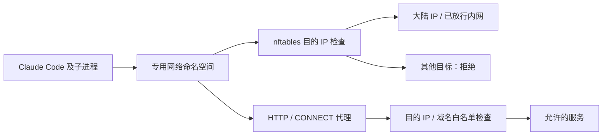

<div align="center">


**为 Claude Code 配置可控的网络出口。**

大陆 IP 直接访问 · 境外目标按白名单放行 · 独立供应商配置

[](CHANGELOG.md)
[](pyproject.toml)
[](#快速开始)
[](LICENSE)

[](https://github.com/robin-ming/claude_cn/stargazers)
[](https://github.com/robin-ming/claude_cn/issues)
[](https://github.com/robin-ming/claude_cn/commits/main/)

[快速开始](#快速开始) · [网络策略](#网络策略) · [配置指南](#配置指南) · [剪贴板](#剪贴板粘贴) · [文档](#文档与反馈)

</div>

## 为什么使用 claude-cn

让 Claude Code 及其子进程在专用网络命名空间中运行：大陆 IP 和指定内网可以直连，境外 IP 直连受限，白名单中的境外域名可通过代理访问。限制由内核规则执行，不依赖程序是否遵守代理环境变量。

| 能力 | 说明 |
| :--- | :--- |
| **双栈出口控制** | IPv4 / IPv6，TCP / UDP / ICMP；命名空间与宿主接口两层 nftables 规则 |
| **境外域名白名单** | 通过 HTTP / CONNECT 代理访问，检查 DNS 结果并连接已核验的 IP |
| **独立供应商配置** | 默认智谱 GLM 5.3，也可配置其他 Claude Code 兼容 API |
| **日常无需 sudo** | 首次授权后直接启动，支持交互终端、管道和恢复会话 |
| **桌面截图粘贴** | X11 / Wayland 只读剪贴板桥接；图片默认开放，文字按需开启 |
| **可维护的安装方式** | Debian 安装包、systemd 服务、自动 IP 库更新与诊断命令 |

Claude Code 本体需另行安装。claude-cn 提供启动器和网络控制，不随包分发 Claude Code，也不依赖 `claude-glm`。

## 快速开始

### 1. 准备环境

- 使用 apt / dpkg 和 systemd 的 Linux 系统。
- Python **3.12 或以上**，以及已安装的 Claude Code 命令行程序。
- 安装与首次授权需要管理员权限。

### 2. 构建通用安装包

```bash
git clone https://github.com/robin-ming/claude_cn.git
cd claude_cn

sudo apt install python3 make dpkg-dev ca-certificates
python3 -m claude_cn.update --output data/cn-networks.json
make deb
```

构建使用 Python 标准库，不需要 Docker 或第三方 Python 模块。IP 快照会随包提供，安装时不必重新下载。

### 3. 安装并配置

在准备运行 Claude Code 的普通用户终端中执行：

```bash
sudo apt install ./dist/claude-cn_0.5.0_all.deb
sudo claude-cn-admin setup --user "$(id -un)"

claude-cn configure       # 隐藏输入供应商 API Key
claude-cn doctor          # 检查程序入口、配置和服务
claude-cn version
```

首次安装不会自动注册用户或启用网络；`setup` 才会初始化用户配置并启动服务。已有用户供应商配置会保留，安装包依赖由 apt 处理。

### 4. 开始使用

```bash
cd /path/to/your-project
claude-cn

claude-cn --resume        # 恢复 Claude Code 会话
claude-cn run --help      # 查看 Claude Code 帮助
claude-cn self-test       # 检查网络边界，不调用模型 API
```

日常启动不需要 sudo，也无需退出登录。`claude-cn version` 显示本项目版本，`claude-cn --version` 则传给 Claude Code。

## 网络策略

| 目标 | 直接 TCP / UDP / ICMP | HTTP / CONNECT 代理 |
| :--- | :---: | :---: |
| 大陆 IPv4 / IPv6 | 允许，不限端口 | 允许所有 TCP 端口 |
| 明确放行的内网 | 允许，不限端口 | 允许所有 TCP 端口 |
| 境外白名单域名 | 境外 IP 直连拒绝 | 默认允许 TCP 80 / 443 |
| 其他境外目标 | 拒绝 | 拒绝 |



**默认例外。** 境外域名白名单包含 GitHub 及其相关资源域名；内网默认放行 `10.0.0.0/8`、`192.168.8.0/24` 和 `192.168.10.0/24`。请按实际环境调整，完整默认值见 [config/policy.json](config/policy.json)。

修改策略后重新加载：

```bash
sudoedit /etc/claude-cn/policy.json
sudo claude-cn-admin reload
```

| 配置项 | 作用 |
| :--- | :--- |
| `allow_domains` | 境外代理域名；`*.example.com` 不包含根域名 |
| `allow_cidrs` | 额外放行的直连 IP 网段 |
| `ports` | 非豁免目标的代理端口，默认 `[80, 443]`；不限制内核直连规则 |
| `allow_clipboard_text` | 是否开启桥接的文本读取，默认 `false` |

大陆按运营商 / BGP / 登记 IP 库判断，存在归属误差；它不是物理传输路径保证。允许服务的后续转发不在策略控制范围内，允许目的地也不等于防止内容外泄。

## 配置指南

### 开发模式与严格模式

升级后默认继续使用 **严格模式**；旧 runtime.json 未填写 `mode` 时也按严格模式处理。

```bash
claude-cn mode                            # 查看默认模式
sudo claude-cn-admin mode development      # 切换开发模式，下次启动生效
sudo claude-cn-admin mode strict           # 恢复严格模式，下次启动生效
```

| 功能 | 开发模式 `development` | 严格模式 `strict` |
| :--- | :--- | :--- |
| 网络命名空间、出口白名单、HTTP 代理 | 保留 | 保留 |
| Docker socket、SSH/GPG Agent、桌面 IPC | 允许，受当前用户权限约束 | 禁止创建 Unix socket |
| 调试、io_uring、提权工具 | 不附加 seccomp / NoNewPrivs 限制 | 保留原有系统调用与提权限制 |
| 终端环境变量 | 继承开发工具、桌面、凭据等变量 | 只继承终端、语言、PATH 等少量变量 |
| 剪贴板 | 原生工具，完整读写，不加类型、大小、频率或 primary 限制 | 只读桥接，文本默认关闭 |

开发模式不会前置剪贴板垫片，不依赖剪贴板桥接服务；实际能力由宿主桌面会话、工具及用户权限决定。两种模式均清理继承的加载器、Python、Claude/Anthropic 和代理变量，供应商继续由独立配置提供。`PATH` 保留；`PYTHONPATH` 等 Python 启动变量不继承，可在会话内为具体工具设置。

**开发模式控制常规网络出口，不保证阻止主动绕过。** Docker、宿主 IPC 和提权能力可能让程序借宿主服务间接联网。两种模式仍使用独立网络命名空间：宿主 `127.0.0.1` 服务不会自动可达，开发服务器对外访问也仍需相应监听和路由配置。

模式由管理员写入 `/etc/claude-cn/runtime.json` 的 `mode` 字段，只影响新会话，无需重启服务；已有会话保持原模式。当前会话模式可用 `echo "$CLAUDE_CN_MODE"` 查看。

### 切换供应商与模型

默认 API 为 `https://open.bigmodel.cn/api/anthropic`，模型为 `glm-5.3[1m]`。也可改为其他 Claude Code 支持的供应商接口：

```bash
claude-cn configure \
  --base-url https://api.example.cn/anthropic \
  --model your-model
```

API Key 交互输入，不需要写进命令行。仅提供 OpenAI 格式的服务需另行转换为 Claude Code 支持的接口。境外供应商仍需加入网络白名单，内网 API 地址需命中允许的 CIDR。

| 配置文件 | 用途 | 管理方式 |
| :--- | :--- | :--- |
| `/etc/claude-cn/policy.json` | 网络策略、文本剪贴板开关 | 管理员 |
| `/etc/claude-cn/runtime.json` | Claude 入口与用户配置路径 | 管理员 |
| `/etc/claude-cn/provider.json` | 首次初始化的供应商模板 | root，`0600` |
| `~/.config/claude-cn/settings.json` | 实际使用的地址、Key 和模型 | 当前用户，`0600` |

<details>
<summary><strong>自定义 Claude 安装入口</strong></summary>

编辑 `/etc/claude-cn/runtime.json`：

```json
{
  "claude_path": "auto",
  "settings_path": "~/.config/claude-cn/settings.json"
}
```

`auto` 依次查找调用者 PATH 中的 `claude`、`~/.local/bin/claude`、`~/.npm-global/bin/claude`、`/usr/local/bin/claude`、`/usr/bin/claude`。支持原生安装器及 npm / nvm 入口；shell alias 和 function 不作为可执行入口。

也可设置稳定的绝对路径或 `~/...`，例如 `/opt/claude/bin/claude`。保留安装器的稳定入口即可，无需固定某个版本目录。显式入口不可用时会报错，不自动换用其他程序。

修改后下次启动生效。若更改 `settings_path`，用 `claude-cn init` 初始化新位置，或自行创建权限为 `0600` 的配置。

</details>

<details>
<summary><strong>初始化或导入已有供应商配置</strong></summary>

```bash
claude-cn init                         # 保留已有配置
claude-cn init --from /path/to/settings.json
claude-cn configure
```

也可以编辑用户配置中的 `env`。字段示例见 [config/zhipu.example.json](config/zhipu.example.json)。

</details>

## 剪贴板粘贴

开发模式使用宿主原生剪贴板，支持完整读写。以下限制只适用于严格模式。

严格模式支持通过只读桥接向 Claude Code 粘贴截图。**图片默认开放，桥接的文字读取默认关闭。** 在 `/etc/claude-cn/policy.json` 中将 `allow_clipboard_text` 改为 `true` 后，重启服务：

```bash
sudo systemctl restart claude-cn-clip.service
```

| 项目 | 范围 |
| :--- | :--- |
| 桌面后端 | X11 / Wayland，失败时按剩余预算尝试另一后端 |
| 图片类型 | PNG、JPEG / JPG、GIF、WebP、BMP |
| 文本类型 | 开启后允许纯文本、UTF-8 charset 变体及 `UTF8_STRING` |
| 读取限制 | 单次 16 MiB、单工具调用最多 5 秒、每分钟 30 次请求 |
| 操作方向 | 只读 clipboard，不提供写入或 primary 选择区 |

宿主桥接服务只允许 Unix socket，拒绝远程 TCP DISPLAY；沙箱中的垫片通过专用命名空间回环 relay 读取结果。无图形会话或剪贴板服务失败不影响 Claude 会话启动。升级后重新启动 Claude 会话即可使用新垫片。

桥接允许会话内程序随时读取已开放类型，无法区分用户按键与程序主动读取。可查看审计日志，或停止服务关闭功能：

```bash
journalctl -u claude-cn-clip.service -n 50 --no-pager
sudo systemctl stop claude-cn-clip.service claude-cn-clip-relay.service
```

## 验证与维护

```bash
claude-cn doctor
claude-cn self-test
journalctl -u claude-cn-netns.service -u claude-cn-proxy.service -n 60 --no-pager
```

管理员可运行隔离网络实验，使用临时命名空间验证路由与拒绝规则：

```bash
sudo python3 /usr/share/claude-cn/integration_network.py
```

### 更新与升级

大陆 IP 库每天定时更新。新库经过格式、数量、覆盖量和地址集合变化检查；下载或检查失败保留旧库，成功后原子替换并重新加载网络规则。数据源见 [update.py](claude_cn/update.py)。

```bash
sudo systemctl start claude-cn-update.service
sudo apt install ./dist/claude-cn_NEW_VERSION_all.deb
```

升级前退出正在运行的 Claude 会话：升级会重启相关服务。用户供应商配置保留；系统 JSON 由 dpkg conffiles 管理，出现冲突提示时按需选择保留本地策略。已有注册用户通常无需重新 setup。

### 停用与卸载

```bash
sudo claude-cn-admin reset    # 停用服务、撤销授权，保留用户配置
sudo apt remove claude-cn     # 卸载程序，保留配置
sudo apt purge claude-cn      # 另清除系统配置和 IP 缓存，保留用户配置
```

## 工作原理与边界

启动请求经本机 Unix socket 交给 root broker，由内核对端 UID 核验注册用户。启动子进程检查网络边界、进入命名空间并设置 DNS，随后降回用户身份，严格模式安装 seccomp，最后运行 Claude Code。服务或边界缺失时拒绝启动。

网络通过专用 veth、双栈 NAT 和 nftables 工作；会按需启用宿主转发并保留 IPv6 RA 行为，停止时尝试恢复原值。规则匹配项目接口，不清空其他防火墙规则，也不修改宿主默认代理。更多细节见 [网络架构](docs/NETWORK.md)。

**这是网络出口控制工具，不是完整文件沙箱。** Claude 仍拥有运行用户的文件权限。严格模式的 seccomp 限制部分宿主 IPC 与进程注入接口，但不能替代完整的文件、进程和内容隔离。宿主的其他进程不会自动受到这套出口策略约束。

## 开发与构建

```bash
python3 -m claude_cn.update --output data/cn-networks.json
make test
make deb
```

请在 claude-cn 会话外的普通终端执行 `make test`；严格模式会话内的 AF_UNIX 创建限制会使部分测试失败。单元测试不替代真实系统上的网络与桌面验收。

构建采用文件白名单，不包含用户 HOME 或 Claude 私有二进制。公共包使用空 Key 模板。

<details>
<summary><strong>仅供本机的私有配置包</strong></summary>

`make deb-private` 从被 Git 忽略的 `config/zhipu.local.json` 构建 `+local1` 包。它可能包含供应商凭据，包和本地配置应保持 `0600`，仅供本机使用，不应上传到仓库或公共发行附件。通用包和私有包使用相同的软件包名，安装时选择其中一种。

</details>

## 文档与反馈

| 资源 | 内容 |
| :--- | :--- |
| [网络架构](docs/NETWORK.md) | 命名空间、代理、宿主改动与剪贴板桥接 |
| [更新日志](CHANGELOG.md) | 各版本变更 |
| [验证记录](VALIDATION.md) | 测试结果和验收范围 |
| [默认网络策略](config/policy.json) | 域名、网段和端口配置 |
| [第三方说明](THIRD_PARTY.md) | IP 数据来源与许可 |

欢迎通过 [Issues](https://github.com/robin-ming/claude_cn/issues) 反馈问题，或提交 [Pull Request](https://github.com/robin-ming/claude_cn/pulls)。报告问题时请附上版本、系统环境和脱敏后的诊断信息。

## 许可证

[MIT](LICENSE) · IP 数据的许可与归属见 [THIRD_PARTY.md](THIRD_PARTY.md)。
